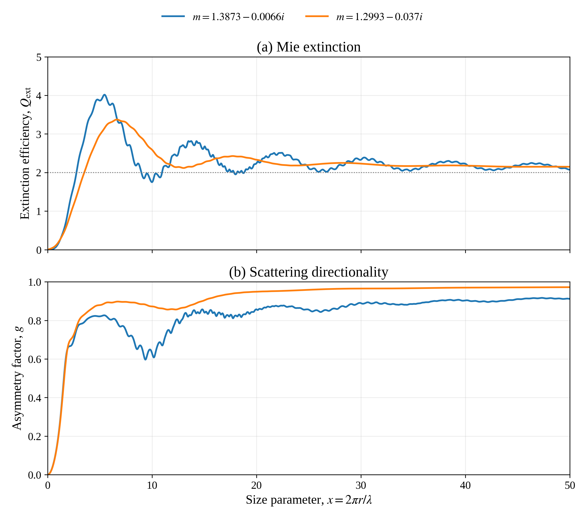

# HW5: Mie Scattering, Part I

We are proceeding one question at a time. Question 1 establishes what the
supplied program calculates and runs its existing baseline. Question 2
reproduces extinction efficiency and asymmetry factor versus size parameter.
Questions 3-4 have not been implemented here.

The assignment and supplied source are in `/scratch/omidzandi/RTM/HW5/`.
An unchanged copy of the source is kept in
[`reference/2026_HW5_F90.f.txt`](reference/2026_HW5_F90.f.txt).
The compilable Question 1 driver is
[`fortran/hw5_question1.f`](fortran/hw5_question1.f).

## Question 1: Inputs And Outputs

The supplied `DMIESS` routine calculates Mie scattering by a core-shell
sphere. For this homework, the assignment specifies equal inner and outer
radii. The baseline also sets equal core and shell refractive indices, so
it represents one homogeneous sphere.

This is a single-particle optical-property calculation. It does not follow
photons through a cloud or compute cloud-top reflectivity, cloud transmission,
or surface energy balance. Its efficiencies, asymmetry factor, and phase
function describe the particles that an atmospheric transport model would use.

### Inputs

| Variable | Meaning | Baseline |
|---|---|---:|
| `ROUT` | Outer particle radius | 2 micrometers |
| `RIN` | Inner/core radius | 2 micrometers |
| `ALAM(1)` | Vacuum wavelength in the surrounding air approximation | 0.55 micrometers |
| `WNUM` | Wavenumber $2\pi/\lambda$ | Reciprocal micrometers |
| `RFRO`, `RFIO` | Shell refractive-index real part and absorption magnitude | 1.299, 0.037 |
| `RFRI`, `RFII` | Core refractive-index real part and absorption magnitude | 1.299, 0.037 |
| `THETA` | Scattering angles relative to the incoming ray | 0-180 degrees, 1-degree steps |
| `JX` | Number of explicitly computed angles from 0 to 90 degrees | 91 |

Radius and wavelength must use the same length units. The routine constructs
`DCMPLX(RFR, -RFI)`, so a positive input `RFI=0.037` represents
$m=1.299-0.037i$ in this code's sign convention. The sign of the imaginary
part must be interpreted with the convention used by the solver; the
assignment figures use the alternative positive-imaginary notation.

The size parameter is

$$
x=\frac{2\pi r}{\lambda}=r\,\mathrm{WNUM}.
$$

The arrays contain other radii, wavelengths, and refractive indices, but the
supplied loops are `I=1,1` and `J=1,1`; only the first entries are used in
this baseline. Before a later radius sweep, `RIN` must follow `ROUT` for
every call, not remain fixed at the first radius.

### Outputs

For a cross-section $C$ and geometric area $\pi r^2$, an efficiency is
$Q=C/(\pi r^2)$.

| Quantity | Definition or interpretation |
|---|---|
| `QEXT` | Extinction efficiency, accounting for scattering plus absorption |
| `QSCAT` | Scattering efficiency |
| `QABS` | Absorption efficiency, calculated as `QEXT-QSCAT` |
| `CTBRQS` | $gQ_{\mathrm{scat}}$, not $g$ by itself |
| `asym` | $g=\mathrm{CTBRQS}/Q_{\mathrm{scat}}=\langle\cos\Theta\rangle$ |
| `SCAT` | Scattering cross-section $\pi r^2Q_{\mathrm{scat}}$, in square micrometers here |
| `QSCAT/QEXT` | Single-scattering albedo $\omega_0$ |
| `ELTRMX` | Scattering-matrix quantities used by the driver to form the phase function |
| `PHASE` | Angular scattering distribution in the driver's normalization |

`QBS` is also returned, but its label is inconsistent in the supplied
comments. The implemented expression is
`RX**2 * (QBSR**2 + QBSI**2) / (4*pi)`, where `RX=1/x`.
It is a normalized backscatter quantity, not an area-valued cross-section.
Its convention must be checked before comparing it with another library's
backscatter efficiency. It is not used in Question 1's consistency checks.

The driver uses `ANRM=2*pi/(WNUM**2*SCAT)` and sums the two polarization
intensities. Thus its phase function uses the normalization

$$
\frac{1}{4\pi}\int P(\Theta)\,d\Omega=1.
$$

This differs from the unit-solid-angle-integral HG function in our Monte
Carlo documentation. Divide the driver's $P$ by $4\pi$ to express it in
that convention. The supplied file already has its phase-output statements
active; the baseline retains them but makes no Question 4 phase-function plot.

### Baseline Results

| Quantity | Result |
|---|---:|
| Size parameter $x$ | 22.847944260 |
| $Q_{\mathrm{ext}}$ | 2.190776 |
| $Q_{\mathrm{scat}}$ | 1.122892813 |
| $Q_{\mathrm{abs}}$ | 1.067883 |
| Single-scattering albedo $\omega_0$ | 0.512554823 |
| Asymmetry factor $g$ | 0.953600008 |
| Scattering cross-section | 14.110686 square micrometers |

The positive $g$ close to one indicates strongly forward-peaked scattering.
About 51.3% of extinction is scattering and 48.7% is absorption for this
particle. These are single-particle ratios, not the probabilities of a photon
being reflected or transmitted by an entire cloud. An extinction efficiency
greater than one does not violate conservation: its denominator is geometric
area, not incident energy over the full electromagnetic scattering interaction.

## Compile And Run On Rain

From the Git repository root `/scratch/omidzandi/RTM/HW1`:

```bash
mkdir -p HW5/build HW5/results
gfortran -std=legacy -ffixed-line-length-none -O0 -g \
  -fcheck=all -ffpe-trap=invalid,zero,overflow \
  HW5/fortran/hw5_question1.f -o HW5/build/hw5_question1
HW5/build/hw5_question1 | tee HW5/results/question1_baseline.txt
```

The source is fixed-form Fortran despite the supplied filename containing
`F90`; `-ffixed-line-length-none` preserves statements beyond column 72.
Generated build files are ignored by Git. The baseline output and Question 2
reference CSV and figures are tracked for viewing on GitHub.

The original file fails to compile because the unused format statement
`F9.6+2x` contains an invalid separator. The working copy corrects it to
`F12.6,2x`, restores the scalar summary output, and prints size parameter,
scattering efficiency, single-scattering albedo, and double-precision $g$.
No changes were made to `DMIESS`; its text matches the original byte for byte.

The run completed with array bounds and floating-point exception checks
enabled. The printed efficiencies satisfy $Q_{\mathrm{ext}}=Q_{\mathrm{scat}}
+Q_{\mathrm{abs}}$ at the printed precision, $0\leq\omega_0\leq1$,
$-1\leq g\leq1$, and the scattering cross-section is consistent with
$\pi r^2Q_{\mathrm{scat}}$. These are internal consistency checks, not an
independent validation of Mie theory. The original main program retains its
single-precision data arrays and rounded pi constant; the baseline is
documented at the corresponding precision.

## Question 2: Efficiencies And Directionality Versus Size

Run from the repository root:

```bash
python -m HW5.hw5_question2
```

The Python driver calls a batch Fortran interface to the supplied `DMIESS`
routine. `fortran/dmiess.f` preserves its routine statements; no Mie core
algorithm was rewritten. Both inner and outer radii are set to the current
particle radius for every call, and both material indices are identical.
The driver uses double-precision inputs and pi, without changing the
Question 1 baseline. The efficiencies and asymmetry factor come directly
from the series, so they do not require numerical integration of sampled
scattering angles.

Inputs follow the assignment graph, rather than the rounded values in the
supplied driver's comments:

| Color | Real index | Absorption magnitude | Fortran convention |
|---|---:|---:|---|
| Blue | 1.3873 | 0.0066 | $1.3873-0.0066i$ |
| Orange | 1.2993 | 0.037 | $1.2993-0.037i$ |

Each case uses $x=0.05,0.10,\ldots,50.00$, giving 1,000 points per
material. The axes extend to zero, but the solver is not called at $x=0$:
the zero-radius case has no scattering, so the ratio defining $g$ would be
undefined. A fixed wavelength of 0.55 micrometers sets
$r=x\lambda/(2\pi)$; for fixed refractive index the dimensionless results
depend on $x$, not separately on wavelength and radius.

### Plots And Presentation Notes



- [Combined figure, PNG](figures/question2_mie_size_parameter.png) and
  [PDF](figures/question2_mie_size_parameter.pdf).
- [Extinction panel, PNG](figures/question2_extinction.png) and
  [PDF](figures/question2_extinction.pdf).
- [Asymmetry panel, PNG](figures/question2_asymmetry.png) and
  [PDF](figures/question2_asymmetry.pdf).
- [Presentation interpretation and caption](question2_presentation.md).
- [All 2,000 numerical cases](results/question2_mie_results.csv), including
  radius, extinction, scattering, absorption, $g$, and single-scattering albedo.

All PNG figures are saved at 300 DPI, with Times-style fonts and vector PDF
versions. The dotted line in the extinction panel marks $Q_{\mathrm{ext}}=2$.
Neither efficiency nor $g$ values are smoothed or clipped.

The first extinction maximum is about 4.017 at $x=5.45$ for the blue case,
and 3.373 at $x=6.65$ for the orange case, on the 0.05 grid. Both curves
oscillate toward the large-size extinction limit, while $g$ generally grows
with nonmonotonic structure. At $x=50$, $g$ is approximately 0.9112 (blue)
and 0.9721 (orange). Larger $g$ describes scattered-light directionality,
not the fraction of incident energy that survives absorption.

### Validation

```bash
python -m HW5.reference_mie
python -m unittest discover -s tests -v
```

Running the supplied routine requires `gfortran`; NumPy and Matplotlib are
the Python dependencies for the sweep and plots. SciPy, already available on
Rain, is used only by the independent reference calculation. Its related
unit test is explicitly skipped when SciPy is unavailable; it is not a
dependency of the Fortran engine.

`reference_mie.py` independently evaluates homogeneous-sphere Mie
coefficients using SciPy spherical Bessel functions and their derivatives,
rather than the supplied coated-sphere recurrence. With $m=n-ik$, it uses
the second-kind outgoing Hankel convention. Over all 2,000 saved cases,
maximum absolute differences are $2.841\times10^{-7}$ in $Q_{\mathrm{ext}}$,
$7.386\times10^{-13}$ in $Q_{\mathrm{scat}}$, and
$6.644\times10^{-8}$ in $g$. The agreement is sufficient for reproducing
the assignment curves, but is not a claim of machine-precision accuracy
from the legacy routine.

The six Mie tests cover preservation of the supplied subroutine, the full
grid, independent reference cases, a nonabsorbing control
($Q_{\mathrm{ext}}=Q_{\mathrm{scat}}$), invariance at fixed $x$, and invalid
inputs. Compilation includes array bounds checks and floating-point traps.
The original routine's convergence thresholds and workspace limits remain
in effect; ranges beyond the homework's $0.05\leq x\leq50$ have not been
validated here.
