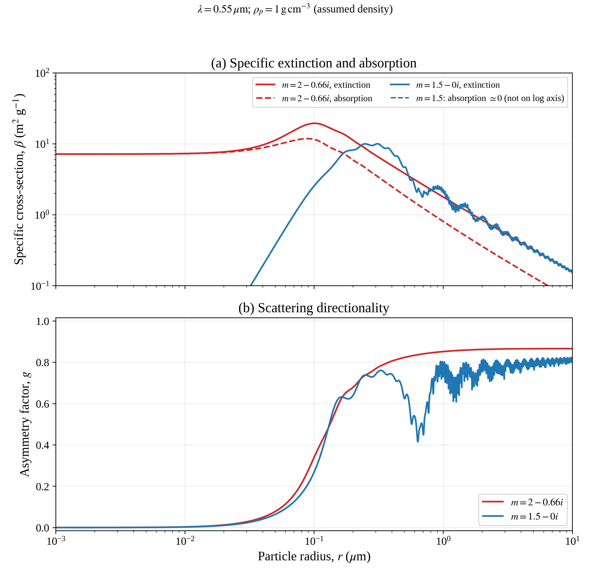

# HW5: Mie Scattering, Part I

We are proceeding one question at a time. Question 1 establishes what the
supplied program calculates and runs its existing baseline. Question 2
reproduces extinction efficiency and asymmetry factor versus size parameter.
Question 3 adds mass-specific extinction/absorption and asymmetry versus
radius. Question 4 has not been implemented here.

The assignment and supplied source are in `/scratch/omidzandi/RTM/HW5/`.
An unchanged copy of the source is kept in
[`reference/2026_HW5_F90.f.txt`](reference/2026_HW5_F90.f.txt).
The compilable Question 1 driver is
[`fortran/hw5_question1.f`](fortran/hw5_question1.f).

## Question 1: Inputs And Outputs

The supplied `DMIESS` routine calculates Mie scattering by a core-shell
sphere. For this homework, the assignment specifies equal inner and outer
radii. The baseline also sets equal core and shell refractive indices, so
it represents one homogeneous sphere.

This is a single-particle optical-property calculation. It does not follow
photons through a cloud or compute cloud-top reflectivity, cloud transmission,
or surface energy balance. Its efficiencies, asymmetry factor, and phase
function describe the particles that an atmospheric transport model would use.

### Inputs

| Variable | Meaning | Baseline |
|---|---|---:|
| `ROUT` | Outer particle radius | 2 micrometers |
| `RIN` | Inner/core radius | 2 micrometers |
| `ALAM(1)` | Vacuum wavelength in the surrounding air approximation | 0.55 micrometers |
| `WNUM` | Wavenumber $2\pi/\lambda$ | Reciprocal micrometers |
| `RFRO`, `RFIO` | Shell refractive-index real part and absorption magnitude | 1.299, 0.037 |
| `RFRI`, `RFII` | Core refractive-index real part and absorption magnitude | 1.299, 0.037 |
| `THETA` | Scattering angles relative to the incoming ray | 0-180 degrees, 1-degree steps |
| `JX` | Number of explicitly computed angles from 0 to 90 degrees | 91 |

Radius and wavelength must use the same length units. The routine constructs
`DCMPLX(RFR, -RFI)`, so a positive input `RFI=0.037` represents
$m=1.299-0.037i$ in this code's sign convention. The sign of the imaginary
part must be interpreted with the convention used by the solver; the
assignment figures use the alternative positive-imaginary notation.

The size parameter is

$$
x=\frac{2\pi r}{\lambda}=r\,\mathrm{WNUM}.
$$

The arrays contain other radii, wavelengths, and refractive indices, but the
supplied loops are `I=1,1` and `J=1,1`; only the first entries are used in
this baseline. Before a later radius sweep, `RIN` must follow `ROUT` for
every call, not remain fixed at the first radius.

### Outputs

For a cross-section $C$ and geometric area $\pi r^2$, an efficiency is
$Q=C/(\pi r^2)$.

| Quantity | Definition or interpretation |
|---|---|
| `QEXT` | Extinction efficiency, accounting for scattering plus absorption |
| `QSCAT` | Scattering efficiency |
| `QABS` | Absorption efficiency, calculated as `QEXT-QSCAT` |
| `CTBRQS` | $gQ_{\mathrm{scat}}$, not $g$ by itself |
| `asym` | $g=\mathrm{CTBRQS}/Q_{\mathrm{scat}}=\langle\cos\Theta\rangle$ |
| `SCAT` | Scattering cross-section $\pi r^2Q_{\mathrm{scat}}$, in square micrometers here |
| `QSCAT/QEXT` | Single-scattering albedo $\omega_0$ |
| `ELTRMX` | Scattering-matrix quantities used by the driver to form the phase function |
| `PHASE` | Angular scattering distribution in the driver's normalization |

`QBS` is also returned, but its label is inconsistent in the supplied
comments. The implemented expression is
`RX**2 * (QBSR**2 + QBSI**2) / (4*pi)`, where `RX=1/x`.
It is a normalized backscatter quantity, not an area-valued cross-section.
Its convention must be checked before comparing it with another library's
backscatter efficiency. It is not used in Question 1's consistency checks.

The driver uses `ANRM=2*pi/(WNUM**2*SCAT)` and sums the two polarization
intensities. Thus its phase function uses the normalization

$$
\frac{1}{4\pi}\int P(\Theta)\,d\Omega=1.
$$

This differs from the unit-solid-angle-integral HG function in our Monte
Carlo documentation. Divide the driver's $P$ by $4\pi$ to express it in
that convention. The supplied file already has its phase-output statements
active; the baseline retains them but makes no Question 4 phase-function plot.

### Baseline Results

| Quantity | Result |
|---|---:|
| Size parameter $x$ | 22.847944260 |
| $Q_{\mathrm{ext}}$ | 2.190776 |
| $Q_{\mathrm{scat}}$ | 1.122892813 |
| $Q_{\mathrm{abs}}$ | 1.067883 |
| Single-scattering albedo $\omega_0$ | 0.512554823 |
| Asymmetry factor $g$ | 0.953600008 |
| Scattering cross-section | 14.110686 square micrometers |

The positive $g$ close to one indicates strongly forward-peaked scattering.
About 51.3% of extinction is scattering and 48.7% is absorption for this
particle. These are single-particle ratios, not the probabilities of a photon
being reflected or transmitted by an entire cloud. An extinction efficiency
greater than one does not violate conservation: its denominator is geometric
area, not incident energy over the full electromagnetic scattering interaction.

## Compile And Run On Rain

From the Git repository root `/scratch/omidzandi/RTM/HW1`:

```bash
mkdir -p HW5/build HW5/results
gfortran -std=legacy -ffixed-line-length-none -O0 -g \
  -fcheck=all -ffpe-trap=invalid,zero,overflow \
  HW5/fortran/hw5_question1.f -o HW5/build/hw5_question1
HW5/build/hw5_question1 | tee HW5/results/question1_baseline.txt
```

The source is fixed-form Fortran despite the supplied filename containing
`F90`; `-ffixed-line-length-none` preserves statements beyond column 72.
Generated build files are ignored by Git. The baseline output and Question 2
reference CSV and figures are tracked for viewing on GitHub.

The original file fails to compile because the unused format statement
`F9.6+2x` contains an invalid separator. The working copy corrects it to
`F12.6,2x`, restores the scalar summary output, and prints size parameter,
scattering efficiency, single-scattering albedo, and double-precision $g$.
No changes were made to `DMIESS`; its text matches the original byte for byte.

The run completed with array bounds and floating-point exception checks
enabled. The printed efficiencies satisfy $Q_{\mathrm{ext}}=Q_{\mathrm{scat}}
+Q_{\mathrm{abs}}$ at the printed precision, $0\leq\omega_0\leq1$,
$-1\leq g\leq1$, and the scattering cross-section is consistent with
$\pi r^2Q_{\mathrm{scat}}$. These are internal consistency checks, not an
independent validation of Mie theory. The original main program retains its
single-precision data arrays and rounded pi constant; the baseline is
documented at the corresponding precision.

## Question 2: Efficiencies And Directionality Versus Size

Run from the repository root:

```bash
python -m HW5.hw5_question2
```

The Python driver calls a batch Fortran interface to the supplied `DMIESS`
routine. The original routine is preserved under `reference/`; the shared
working copy now contains the homogeneous-sphere and convergence safeguards
documented under Question 3 below. Both inner and outer radii are set to the current
particle radius for every call, and both material indices are identical.
The driver uses double-precision inputs and pi, without changing the
Question 1 baseline. The efficiencies and asymmetry factor come directly
from the series, so they do not require numerical integration of sampled
scattering angles.

Inputs follow the assignment graph, rather than the rounded values in the
supplied driver's comments:

| Color | Real index | Absorption magnitude | Fortran convention |
|---|---:|---:|---|
| Blue | 1.3873 | 0.0066 | $1.3873-0.0066i$ |
| Orange | 1.2993 | 0.037 | $1.2993-0.037i$ |

Each case uses $x=0.05,0.10,\ldots,50.00$, giving 1,000 points per
material. The axes extend to zero, but the solver is not called at $x=0$:
the zero-radius case has no scattering, so the ratio defining $g$ would be
undefined. A fixed wavelength of 0.55 micrometers sets
$r=x\lambda/(2\pi)$; for fixed refractive index the dimensionless results
depend on $x$, not separately on wavelength and radius.

### Plots And Presentation Notes


- [Combined figure, PNG](figures/question2_mie_size_parameter.png) and
  [PDF](figures/question2_mie_size_parameter.pdf).
- [Extinction panel, PNG](figures/question2_extinction.png) and
  [PDF](figures/question2_extinction.pdf).
- [Asymmetry panel, PNG](figures/question2_asymmetry.png) and
  [PDF](figures/question2_asymmetry.pdf).
- [Presentation interpretation and caption](question2_presentation.md).
- [All 2,000 numerical cases](results/question2_mie_results.csv), including
  radius, extinction, scattering, absorption, $g$, and single-scattering albedo.

All PNG figures are saved at 300 DPI, with Times-style fonts and vector PDF
versions. The dotted line in the extinction panel marks $Q_{\mathrm{ext}}=2$.
Neither efficiency nor $g$ values are smoothed or clipped.

The first extinction maximum is about 4.017 at $x=5.45$ for the blue case,
and 3.373 at $x=6.65$ for the orange case, on the 0.05 grid. Both curves
oscillate toward the large-size extinction limit, while $g$ generally grows
with nonmonotonic structure. At $x=50$, $g$ is approximately 0.9112 (blue)
and 0.9721 (orange). Larger $g$ describes scattered-light directionality,
not the fraction of incident energy that survives absorption.

### Validation

```bash
python -m HW5.reference_mie
python -m unittest discover -s tests -v
```

Running the supplied routine requires `gfortran`; NumPy and Matplotlib are
the Python dependencies for the sweep and plots. SciPy, already available on
Rain, is used only by the independent reference calculation. Its related
unit test is explicitly skipped when SciPy is unavailable; it is not a
dependency of the Fortran engine.

`reference_mie.py` independently evaluates homogeneous-sphere Mie
coefficients using SciPy spherical Bessel functions and their derivatives,
rather than the supplied coated-sphere recurrence. With $m=n-ik$, it uses
the second-kind outgoing Hankel convention. Over all 2,000 saved cases,
maximum absolute differences are $2.841\times10^{-7}$ in $Q_{\mathrm{ext}}$,
$7.386\times10^{-13}$ in $Q_{\mathrm{scat}}$, and
$6.644\times10^{-8}$ in $g$. The agreement is sufficient for reproducing
the assignment curves, but is not a claim of machine-precision accuracy
from the legacy routine.

The Mie tests cover the documented scope of changes to the supplied routine, the full
grid, independent reference cases, a nonabsorbing control
($Q_{\mathrm{ext}}=Q_{\mathrm{scat}}$), invariance at fixed $x$, and invalid
inputs. Compilation includes array bounds checks and floating-point traps.
Question 3 also checks compatibility with the saved Question 2 curves to
$5\times10^{-7}$ absolute tolerance. The original workspace limits remain
in effect; the wider radius range is validated separately below.

## Question 3: Mass-Specific Cross-Sections Versus Radius

```bash
python -m HW5.hw5_question3
python -m HW5.validate_question3
```

The two required cases are $m=2-0.66i$ (absorbing) and $m=1.5-0i$
(nonabsorbing). Both use homogeneous spheres with equal core and outer radii.
The radius range is 0.001-10 micrometers, sampled at 5,451 radii per material.
Logarithmic sampling below 0.1 micrometers resolves the small-particle regime;
0.002-micrometer steps above that radius resolve the interference structure.

### Wavelength And Density Assumption

The wavelength is 0.55 micrometers, following the supplied driver's first
wavelength and its Question 3 radius conversion. The assignment does not
state a particle mass density. The reference comparison therefore explicitly
assumes **1 g/cm^3 for both materials**, consistent with the scale of the
supplied plot. This is a mass-normalization assumption, not a measured density
or an identification of either material. It is recorded in the CSV and figure.
Using another density changes all specific cross-sections in inverse
proportion, while leaving efficiencies and $g$ unchanged.

Both settings are configurable, for example:

```bash
python -m HW5.hw5_question3 --wavelength-um 0.55 --density-g-cm3 1.0
```

These options regenerate the Question 3 reference filenames with the chosen
parameters; the CSV and figure always state the parameters actually used.

### Mass Normalization

For a spherical particle, its mass is $M_p=(4/3)\pi r^3\rho_p$ and its
extinction cross-section is $C_{\mathrm{ext}}=\pi r^2Q_{\mathrm{ext}}$.
The specific cross-section is

$$
\beta_{\mathrm{ext}}=\frac{C_{\mathrm{ext}}}{M_p}
=\frac{3Q_{\mathrm{ext}}}{4\rho_p r},\qquad
\beta_{\mathrm{abs}}=\frac{3Q_{\mathrm{abs}}}{4\rho_p r}.
$$

In the code's units, $r$ is in micrometers, $\rho_p$ is in g/cm^3, and
$\beta$ is in m^2/g. Converting area to m^2 and mass to grams gives the
numerical expression `0.75 * Q / (density_g_cm3 * radius_um)`. No particle
number concentration is needed for this single-particle mass-specific quantity.

### Figures, Results, And Presentation



- [Combined PNG](figures/question3_mie_radius.png) and
  [PDF](figures/question3_mie_radius.pdf).
- [Specific cross-sections PNG](figures/question3_specific_cross_sections.png)
  and [PDF](figures/question3_specific_cross_sections.pdf).
- [Asymmetry PNG](figures/question3_asymmetry.png) and
  [PDF](figures/question3_asymmetry.pdf).
- [Presentation notes and caption](question3_presentation.md).
- [10,902 numerical cases](results/question3_mie_results.csv).
- [Independent validation summary](results/question3_validation.csv).

Red denotes the absorbing case and blue the nonabsorbing case. Extinction
is solid; absorption is dashed. The top panel uses logarithmic axes with the
same 0.1-100 m^2/g vertical range as the assignment. Values below that range
remain in the CSV. All figures have 300-DPI PNG and vector PDF versions.

The nonabsorbing material has zero physical absorption. Its maximum
absolute numerical $Q_{\mathrm{abs}}$ is $1.332\times10^{-15}$, and the
signed specific absorption residual lies between approximately
$-3.24\times10^{-15}$ and $3.62\times10^{-15}$ m^2/g. These roundoff
residuals are preserved in the CSV. A zero curve cannot be shown on a
logarithmic axis, so it is explicitly identified in the legend rather than
replaced with an arbitrary positive floor.

At the default density, the absorbing case has a sampled specific-extinction
maximum of 19.4133 m^2/g near radius 0.102 micrometers; the nonabsorbing case
peaks near 10.0086 m^2/g at radius 0.310 micrometers. Small absorbing particles
have a nearly constant mass-specific absorption around 7.156 m^2/g. At large
radii both materials' specific extinction decreases approximately as $1/r$,
while their scattered light is predominantly forward-directed.

### Numerical Fixes Required By The Wider Sweep

The supplied source and the Question 1 baseline source remain unchanged.
The shared `fortran/dmiess.f` working copy contains two scoped safeguards:

1. **Exact homogeneous shortcut.** Identical core/shell indices with equal
   radii use the routine's existing homogeneous branch. This avoids a
   removable singularity in coated-sphere expressions at, for example,
   $r=0.55$ micrometers for $m=1.5$ and $\lambda=0.55$ micrometers.
   The per-order homogeneous coefficients are assigned before the
   coated-sphere-specific core-size check. No radius perturbation or
   artificial absorption is introduced.
2. **Series convergence guard.** An isolated small coefficient is not enough
   to stop the series. The original squared-coefficient threshold of
   $10^{-10}$ is applied only after the size-based order estimate
   $N\geq\lceil x+4x^{1/3}+2\rceil$. At radius 8.554 micrometers in the
   nonabsorbing case, early termination previously missed about
   $4.93\times10^{-5}$ in extinction efficiency. The guard resolves it.

The full 10,902-case comparison with the independent direct Bessel series
now gives maximum absolute differences of $1.423\times10^{-11}$ in
extinction/scattering efficiencies, $1.006\times10^{-11}$ in $g$,
$1.472\times10^{-12}$ m^2/g in specific extinction, and
$2.132\times10^{-14}$ m^2/g in specific absorption. The reference converts
area and particle mass explicitly in SI lengths and grams, independently
checking the mass normalization.

Regression tests cover the formerly singular inputs, premature termination,
Question 2 compatibility, the full radius grid, zero absorption, density
scaling, explicit area/mass units, and the Rayleigh limits. All 47 repository
tests passed. The original Question 2 CSV and figures are retained; recomputing
them with the guarded routine changes extinction by at most
$2.841\times10^{-7}$ and $g$ by $6.644\times10^{-8}$, below their documented
validation tolerance and invisible at plot scale.
