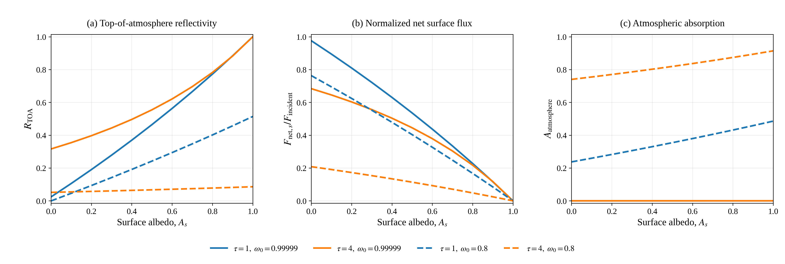

# Radiative Transfer Models

This repository contains Monte Carlo and two-stream radiative transfer models
for ATMO 656A: Atmospheric Radiation and Remote Sensing. Both approaches
describe solar radiation in a homogeneous, plane-parallel atmospheric layer
and calculate how energy is reflected, transmitted, or absorbed.

The Monte Carlo model follows individual photon trajectories. The two-stream
models solve coupled equations for upward and downward radiation, providing
analytical approximations to the angular radiative transfer problem. The
homework experiments progress from isotropic scattering to anisotropic
scattering, atmospheric absorption, and a reflecting lower surface.

## Models And Experiments

| Homework | Model | Main experiments |
|---|---|---|
| [HW1](HW1/) | Monte Carlo, isotropic scattering | Photon-number convergence, independent runs, solar angle, and optical depth |
| [HW2](HW2/) | Monte Carlo, Henyey-Greenstein scattering | Anisotropy, absorption, and matched computational timing comparisons |
| [HW3 Question 1](HW3/README.md) | Meador-Weaver two-stream approximations | Eddington and quadrature reflectivity/transmissivity over a black surface |
| [HW3 Question 2](HW3/README_question2.md) | Liou two-stream discrete ordinates | Independent analytical implementation and comparison with quadrature |
| [HW4](HW4/README.md) | Liou discrete ordinates with a reflecting surface | All cloud-surface reflections, surface absorption, and atmospheric absorption |

The shared implementations are [Monte Carlo transport](models/monte_carlo.py),
[Meador-Weaver two-stream](models/two_stream.py),
[Liou discrete ordinates](models/liou_two_stream.py), and
[reflecting-surface transport](models/surface_two_stream.py).

## Two-Stream Radiative Transfer

A two-stream approximation represents the diffuse radiation field by one
upward and one downward stream. The incident solar beam is treated separately.
Optical depth increases downward, and the solar zenith cosine is positive:
$0<\mu_0\leq1$. These conventions differ from the Monte Carlo model's upward
vertical coordinate and negative incident direction cosine.

For upward and downward diffuse fluxes $U$ and $D$, each normalized by the
incident horizontal solar flux, the coupled equations are

$$
\frac{dU}{d\tau}=\gamma_1U-\gamma_2D
-\frac{\omega_0\gamma_3}{\mu_0}e^{-\tau/\mu_0},
$$

$$
\frac{dD}{d\tau}=\gamma_2U-\gamma_1D
+\frac{\omega_0\gamma_4}{\mu_0}e^{-\tau/\mu_0},
\qquad \gamma_4=1-\gamma_3.
$$

The closure determines the coefficients $\gamma_i$ from single-scattering
albedo $\omega_0$, asymmetry factor $g$, and solar cosine $\mu_0$.
For a layer of total optical depth $\tau_L$ over a black surface,
$D(0)=0$ and $U(\tau_L)=0$. The reflected fraction is $R=U(0)$; total
transmissivity includes both diffuse radiation and the direct beam:

$$
T=D(\tau_L)+e^{-\tau_L/\mu_0},\qquad A=1-R-T.
$$

### Eddington, Quadrature, And Discrete Ordinates

`models/two_stream.py` implements the Eddington and quadrature coefficients
from Meador and Weaver (1980), Table 1, with analytical reflectivity and
transmissivity from Eqs. (14)-(18). The two closures use different
approximations for the angular radiation field. The black-surface equations,
coefficient definitions, and stable exponential forms are documented in
[HW3 Question 1](HW3/README.md).

`models/liou_two_stream.py` independently implements Liou (1974),
Eqs. (5)-(13). Its two Gaussian ordinates are $\pm1/\sqrt{3}$. The
first-order phase-function expansion uses Legendre moments
$\bar\omega_0=\omega_0$ and $\bar\omega_1=3\omega_0g$; it represents the
first two moments of HG scattering rather than sampling the full HG angular
distribution as the Monte Carlo model does.

For the same inputs and phase-function truncation, Liou's two-stream
discrete-ordinate solution and Meador-Weaver quadrature are algebraically
equivalent. Their agreement checks the two analytical implementations; it
does not establish their accuracy relative to a full angular solution.

For conservative scattering, $\omega_0=1$ and
$k=\sqrt{\gamma_1^2-\gamma_2^2}=0$. Both black-surface implementations use
the exact limiting solution rather than adding artificial absorption:

$$
R=\frac{\gamma_1\tau_L+(\gamma_3-\gamma_1\mu_0)
[1-e^{-\tau_L/\mu_0}]}{1+\gamma_1\tau_L},\qquad T=1-R.
$$

### Reflecting Surface And Multiple Reflections

HW4 extends Liou's discrete-ordinate model to a Lambertian surface with
albedo $A_s$. It distinguishes the layer's direct-beam-illuminated
coefficients $R_{\mathrm{dir}},T_{\mathrm{dir}}$ from its bottom-incident
diffuse coefficients $R_{\mathrm{diff}},T_{\mathrm{diff}}$.
Here $T_{\mathrm{dir}}$ includes both unscattered and downward-scattered
sunlight, while $T_{\mathrm{diff}}$ describes transmission of upward diffuse
radiation from the surface to space.

Summing all reflections between the atmosphere and surface gives

$$
R_{\mathrm{TOA}}=R_{\mathrm{dir}}+
\frac{A_sT_{\mathrm{dir}}T_{\mathrm{diff}}}{1-A_sR_{\mathrm{diff}}},
\qquad
\frac{F_{\mathrm{net},s}}{F_{\mathrm{incident}}}=
\frac{(1-A_s)T_{\mathrm{dir}}}{1-A_sR_{\mathrm{diff}}}.
$$

Atmospheric absorption completes the normalized energy partition:

$$
R_{\mathrm{TOA}}+
\frac{F_{\mathrm{net},s}}{F_{\mathrm{incident}}}+A_{\mathrm{atm}}=1.
$$

HW4 sets $\pi F_0=1$, so the incident horizontal flux is
$F_{\mathrm{incident}}=\pi F_0\mu_0=0.9$. CSV flux columns use these units;
the energy-partition panels show fractions of incident horizontal flux.
The [HW4 derivation](HW4/README.md) and
[Question 4 report](HW4/question4_results.md) explain the normalization,
diffuse coefficients, multiple-reflection sum, and physical interpretation.



Blue and orange curves denote optical depths 1 and 4; solid and dashed lines
denote single-scattering albedos 0.99999 and 0.8. A brighter surface increases
TOA reflectivity, while a thick absorbing layer strongly reduces the
surface's influence on radiation observed from above.

### Validation And Limits

The analytical models are checked against direct expressions and an
independent RK4 solution of the coupled equations. Surface tests also check
the reflecting boundary, volume-integrated atmospheric absorption, and a
finite sum of repeated reflections. Energy closure alone is not independent
validation, especially when absorption is inferred as a residual.

Two-stream angular approximations can give slightly negative reflectivity
for thin layers under strongly forward-scattering, nearly vertical
illumination. These results are flagged and retained rather than clipped.
The homework documentation discusses the affected cases and numerical limits.

## Monte Carlo Photon Transport

The bottom of the layer is at `z = 0`, and the top is at
`z = tau * l0`. The vertical coordinate is positive upward, so the incident
solar direction cosine is negative for a downward-moving photon.

The distance to the next interaction is exponentially distributed:

```text
l = -l0 ln(1 - xi),  xi ~ U(0, 1)
```

The photon then moves vertically by:

```text
delta_z = mu * l
```

A photon crossing the top boundary is reflected. A photon crossing the bottom
boundary is transmitted. At an interaction inside the layer, the photon
scatters with probability `omega0` and is absorbed with probability
`1 - omega0`. The model therefore checks:

```text
R + T + A = 1
```

For nonabsorbing simulations, `omega0 = 1`, `A = 0`, and `R + T = 1`.

### Scattering Direction

For isotropic scattering (`g = 0`), the new vertical direction cosine is
uniformly sampled from `[-1, 1]`.

#### Henyey-Greenstein Phase Function

The Henyey-Greenstein (HG) phase function describes the angular distribution
of scattered radiation:

$$
P(\Theta) = \frac{1}{4\pi}
\frac{1-g^2}{\left(1+g^2-2g\cos\Theta\right)^{3/2}}.
$$

The scattering angle $\Theta$ is measured relative to the photon's **current
incoming direction**, rather than relative to the atmospheric vertical. The
asymmetry factor $g$ controls the preferred scattering direction:

- $g=0$ gives isotropic scattering.
- $g>0$ favors forward scattering, with directions near the incoming photon
  direction receiving greater probability.
- HW2 uses $g=0.75$, representing strongly forward-peaked scattering.

#### Inverse-CDF Sampling

Define the scattering-angle cosine as

$$
\mu_s = \cos\Theta.
$$

The function `sample_hg_cos_theta()` samples $\mu_s$ by inverse-transform
sampling. It first draws $\xi\sim U(0,1)$ and computes

$$
q = \frac{1-g^2}{1-g+2g\xi},
$$

followed by

$$
\cos\Theta = \frac{1+g^2-q^2}{2g}.
$$

This is conceptually the same inverse-transform method used to sample the
exponential free path,

$$
l=-l_0\ln(1-\xi),
$$

but the HG inverse CDF samples a scattering angle instead of a path length.
For $g=0$, `sample_hg_cos_theta()` handles the isotropic limit separately by
sampling $\cos\Theta$ uniformly from $[-1,1]$. In the actual isotropic
transport path, `scatter_direction()` directly samples the new vertical
direction cosine from this uniform distribution, preserving the original HW1
behavior.

#### Random Azimuth

Sampling $\Theta$ fixes the opening angle of a cone around the incoming photon
direction, but the photon may scatter anywhere around that cone. The HG phase
function does not impose a preferred azimuthal direction, so the code
independently draws

$$
\phi=2\pi\xi_2, \qquad \xi_2\sim U(0,1).
$$

#### Rotation into the Vertical Coordinate System

Three direction cosines must be distinguished:

- $\cos\Theta$ is relative to the **old photon direction**.
- $\mu_{\mathrm{old}}$ is the old photon direction cosine relative to the
  atmospheric vertical.
- $\mu_{\mathrm{new}}$ is the new photon direction cosine relative to the
  atmospheric vertical.

The function `scatter_direction()` rotates the locally sampled scattering
direction into the global vertical coordinate system using

$$
\mu_{\mathrm{new}} = \mu_{\mathrm{old}}\cos\Theta + \sqrt{1-\mu_{\mathrm{old}}^2}\,\sin\Theta\,\cos\phi.
$$

or equivalently,

$$
\mu_{\mathrm{new}} = \mu_{\mathrm{old}}\cos\Theta + \sqrt{1-\mu_{\mathrm{old}}^2}\,\sqrt{1-\cos^2\Theta}\,\cos\phi.
$$

Only $\mu_{\mathrm{new}}$ must be retained because this plane-parallel model
tracks photon position only along the vertical $z$ coordinate. The horizontal
$x$ and $y$ positions and direction components do not affect whether a photon
leaves through the top or bottom boundary.

#### Scattering Algorithm

For each interaction inside the layer, the model performs these steps:

1. Sample the exponential free path.
2. Move the photon using $\Delta z=\mu l$.
3. Check whether the photon exits through the top or bottom boundary.
4. If absorption is enabled, use $\omega_0$ to decide whether the interaction
   causes scattering or absorption.
5. If scattering occurs, sample the HG scattering angle $\Theta$.
6. Sample an independent random azimuth $\phi$.
7. Rotate the local scattering direction to obtain $\mu_{\mathrm{new}}$.
8. Continue the photon trajectory using the new vertical direction cosine.

### Single-Scattering Albedo

The single-scattering albedo $\omega_0$ determines the outcome of an
interaction inside the layer:

$$
P(\text{scattering})=\omega_0,
\qquad
P(\text{absorption})=1-\omega_0.
$$

An absorbed photon is terminated and added to the absorption count. Therefore,

$$
R+T+A=1.
$$

When $\omega_0=1$, every interaction scatters, absorption is zero, and the
nonabsorbing conservation relation becomes

$$
R+T=1.
$$

## Repository Structure

```text
Radiative_Transfer_Models/
|-- models/
|   |-- liou_two_stream.py
|   |-- monte_carlo.py
|   |-- surface_two_stream.py
|   `-- two_stream.py
|-- HW1/
|   |-- HW1.docx
|   |-- hw1_monte_carlo_photons.py
|   |-- hw1_problem2_independent_runs.py
|   |-- hw1_problem3_incident_direction.py
|   `-- hw1_problem4_optical_depth.py
|-- HW2/
|   |-- hw2_part1_hg_scattering.py
|   |-- hw2_full_experiments.py
|   `-- compare_isotropic_hg_performance.py
|-- HW3/
|   |-- README.md
|   |-- README_question2.md
|   |-- hw3_question1.py
|   |-- hw3_question2.py
|   `-- validate_question1.py
|-- HW4/
|   |-- README.md
|   |-- hw4.py
|   |-- hw4_results.csv
|   |-- question4.py
|   |-- question4_results.md
|   |-- figures/
|   `-- tests/
|-- tests/
|   |-- test_hw4.py
|   |-- test_liou_two_stream.py
|   |-- test_monte_carlo.py
|   `-- test_two_stream.py
`-- requirements.txt
```

`models/monte_carlo.py` defines the shared `MonteCarloTransport` class and the
HG sampling and direction-rotation functions. `models/two_stream.py` exposes
`reflect_transmit()`, and `models/liou_two_stream.py` exposes
`liou_reflect_transmit()` for black-surface layer calculations.
`models/surface_two_stream.py` adds `diffuse_reflect_transmit()` and
`surface_transport()` for a reflecting lower boundary. Homework scripts
configure these shared models for each experiment.

## Installation

Python 3 with NumPy and Matplotlib is required.

```bash
git clone https://github.com/zandi-omid/Radiative_Transfer_Models.git
cd Radiative_Transfer_Models
python -m venv .venv
source .venv/bin/activate
python -m pip install -r requirements.txt
```

Run all commands below from the repository root so Python can import the
shared `models` package.

For example, compare the two black-surface quadrature formulations, then add
a reflecting surface:

```python
from models.two_stream import reflect_transmit
from models.liou_two_stream import liou_reflect_transmit
from models.surface_two_stream import surface_transport

mw_r, mw_t = reflect_transmit(
    tau=4.0, omega0=0.9, mu0=0.5, g=0.75, method="quadrature"
)
liou_r, liou_t = liou_reflect_transmit(
    tau=4.0, omega0=0.9, mu0=0.5, g=0.75
)
surface = surface_transport(
    tau=4.0, surface_albedo=0.5, omega0=0.8, mu0=0.9, g=0.75
)
print(mw_r, mw_t)
print(liou_r, liou_t)
print(surface.toa_reflectivity, surface.surface_net_flux)
```

`surface_transport()` defaults to unit incident horizontal flux, so its flux
outputs in this example are already normalized fractions.

## HW1: Isotropic Scattering

HW1 uses `g = 0` and `omega0 = 1`.

```bash
MPLBACKEND=Agg python -m HW1.hw1_monte_carlo_photons
MPLBACKEND=Agg python -m HW1.hw1_problem2_independent_runs
MPLBACKEND=Agg python -m HW1.hw1_problem3_incident_direction
MPLBACKEND=Agg python -m HW1.hw1_problem4_optical_depth
```

These scripts cover:

1. Convergence with increasing photon number.
2. Ten independent simulations and sample standard deviations.
3. Reflectivity and transmissivity for `mu0 = -0.1, ..., -0.9`.
4. Reflectivity, transmissivity, scattering count, and computation time for
   optical depths `tau = 1, ..., 8`.

## HW2: HG Scattering and Absorption

The tested baseline uses `N = 10,000`, `tau = 4`, `mu0 = -0.7`, `g = 0.75`,
and `omega0 = 1`:

```bash
python -m HW2.hw2_part1_hg_scattering
```

With seed 42 and 24 available workers, the reference result is:

```text
R = 0.423300
T = 0.576700
A = 0.000000
R + T + A = 1.000000
```

Run the complete HW2 experiments with:

```bash
python -m HW2.hw2_full_experiments
```

This uses `N = 10,000` and `g = 0.75` throughout and evaluates
`omega0 = 1.00, 0.95, 0.85, 0.75`. It performs:

- Ten independent simulations for each albedo.
- An incident-angle sweep from `mu0 = -0.1` through `-0.9`.
- An optical-depth sweep from `tau = 1` through `8`.
- Conservation checks for `R + T + A`.
- High-resolution comparison figures for reflectivity, transmissivity, and
  absorptivity.

Numerical tables and figures are written to `HW2/results/`.

## HW3: Two-Stream Models

HW3 Question 1 implements the analytical Eddington and quadrature two-stream
approximations for a homogeneous layer over a black surface. It uses positive
$\mu_0$ following the Meador-Weaver direct-beam convention and treats the
conservative $k=0$ case with its analytical limit.

```bash
python -m HW3.hw3_question1
```

The experiment compares reflectivity and transmissivity over
$0\leq\tau\leq10$ for $\mu_0=0.9,0.5,0.1$, $\omega_0=1.0,0.9$, and $g=0.75$.
Four figures and a CSV table are saved under `HW3/results/`. See
[`HW3/README.md`](HW3/README.md) for the equations, numerical treatment, and
known closure limitations.

Question 2 independently implements Liou's two-stream discrete-ordinate
solution and compares it with the Meador-Weaver quadrature method:

```bash
python -m HW3.hw3_question2
```

The two formulations are algebraically equivalent for the same first-order
phase-function expansion. The comparison retains the direct and diffuse parts
of transmitted flux and uses the exact conservative-scattering limit. See
[`HW3/README_question2.md`](HW3/README_question2.md) for the Liou equations and
interpretation.

Run the independent black-surface ODE comparison with
`python -m HW3.validate_question1`.

## HW4: Reflecting Surface

HW4 adds a Lambertian surface to the Liou discrete-ordinate model and sums all
atmosphere-surface reflections. It compares nearly conservative and absorbing
layers over surfaces ranging from black to perfectly reflecting:

```bash
python -m HW4.hw4
```

See [HW4/README.md](HW4/README.md) for the diffuse coefficients, normalization,
validation, and interpretation. Numerical output is in `HW4/hw4_results.csv`
and PNG/PDF figures are in `HW4/figures/`.

The cases use $\tau=1,4$, $\omega_0=0.99999,0.8$, $\mu_0=0.9$, and
$g=0.75$, with surface albedo from 0 to 1. To reproduce the three-panel
energy-partition figure directly from the saved CSV and check the results:

```bash
python -m HW4.question4
```

The [Question 4 report](HW4/question4_results.md) includes the reflectivity
comparison table, captions, and a discussion of absorbing layers over dark
and bright surfaces.

## Computational Comparison

The performance benchmark compares the original isotropic model (`g = 0`) and
the nonabsorbing HG model (`g = 0.75`) under the same conditions:

```bash
python -m HW2.compare_isotropic_hg_performance
```

The benchmark uses exactly `N = 10,000`, `mu0 = -0.7`, `omega0 = 1`, and
`tau = 1, ..., 8`. Each model is timed five times per optical depth with the
same seeds and worker count. Execution order alternates between models to
reduce ordering bias. The output includes raw timings, timing means and sample
standard deviations, and a wall-clock-time comparison figure with error bars.

## Multiprocessing and Reproducibility

Monte Carlo simulations use up to 24 worker processes; the analytical
two-stream calculations do not use this worker pool:

```text
workers_used = min(requested_workers, available_CPU_count, photon_count)
```

`numpy.random.SeedSequence` creates an independent random-number stream for
each worker. A run is reproducible when its seed and worker count are unchanged.
The benchmark reports the actual worker count in its terminal output and figure
title.

## Tests

Run the automated checks with:

```bash
python -m unittest discover -s tests -v
```

The tests cover photon conservation, reproducibility, HG samples and direction
rotation, two-stream coefficients, zero optical depth, conservative energy
balance, and analytical agreement with independent ODE reference solutions.
HW4 adds black-surface and perfectly reflecting limits, flux normalization,
multiple-reflection sums, and volume-integrated atmospheric absorption.

Most generated experiment figures and result files are excluded from Git and
can be recreated by running the corresponding scripts. The HW4 reference
CSV, PNG/PDF figures, and scientific report are versioned so they can be
viewed directly on GitHub.
